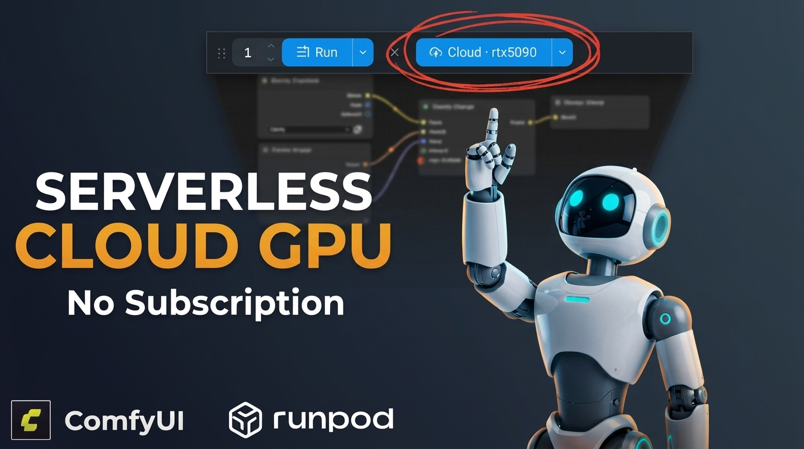

# ComfyUI Serverless Cloud GPU



Edit workflows in your local ComfyUI, run them on a RunPod Serverless GPU. Progress and results show up in your local GUI, and you don't need the models locally.

You need a [RunPod](https://runpod.io?ref=hhaqe53o) account and a GitHub account.
If you register to RunPod with the link above and deposit $10, we both **earn additional 5$**.

## Setup

### 1. Install the plugin

RunPod builds your images from a GitHub repository you own, and the plugin pushes your endpoints there. So the plugin needs its own copy:

1. Go to your `custom_nodes` folder and clone the repository:

```bash
git clone https://github.com/timnielen/comfyui-cloud-gpu.git & cd comfyui-cloud-gpu
```
2. On GitHub, create an empty repository, e.g. `comfyui-cloud-gpu`. Private is fine; don't add a README.
3. Upload a copy of the cloned repository to your own repository:

```bash
git remote rename origin upstream
git remote add origin <your-repository-url>
git push -u origin main
pip install -r requirements.txt
```

To get plugin updates later: `git pull upstream main`, then `git push`. A public fork works too: clone your fork instead and skip the remote commands.

### 2. Credentials

In the plugin folder, copy `.env.example` to `.env`, then:

1. If you don't have a RunPod account yet, sign up with [this link](https://runpod.io?ref=hhaqe53o) (if you register with it and deposit $10, we both **earn additional 5$**).
2. In RunPod, create an API key with read/write access (Credentials → Create API Key → Serverless endpoints → tick read and write → Create).
3. Put the key into `.env` as `RUNPOD_API_KEY`. `.env` is not committed and stays on your computer.

The other lines in `.env` are for an optional bucket; leave them empty for now. See [Bucket (optional)](#bucket-optional).

### 3. First endpoint

1. Start ComfyUI, open the **Cloud** tab in the sidebar and create an endpoint with **New…**, e.g. `flux`. Add its models and node packs.
2. Press **Deploy & release**. This creates the branch `cloud/<name>` in your repo, with the endpoint's Dockerfile, and its first release.

### 4. RunPod endpoint

1. **Serverless → New Endpoint → GitHub repo**, and select your copy of this repo.
2. Branch **`cloud/<name>`**, e.g. `cloud/flux`. Leave the Dockerfile path and build context at their defaults.
3. Choose a GPU with enough VRAM for your models
4. Idle timeout 1–5 s, execution timeout 3600 s (1 hour), FlashBoot on.
5. Container Configuration: Container disk 20 GB
6. Advanced: allow **CUDA 13.x** only.
7. Paste the endpoint's ID into the Cloud tab. If no build starts, press **Deploy & release** again.

## Running

Press **☁ Cloud · endpoint** (showing the selected endpoint) next to the Run button, or **Alt+Enter**. Its arrow picks the endpoint, and its ✕ cancels running cloud jobs. The run shows up in the queue like a local one, and outputs are saved to your local `output/` folder. You can run locally and in the cloud at the same time.

Model dropdowns also list the models of your cloud endpoints, so you can pick them without having them locally. A local Run with such a model reports it as missing.

Before anything is sent, the workflow is checked against the endpoint's manifest. Models or node packs the cloud image doesn't have are marked on the nodes, as they would be for a local run, and no worker is started.

## Changing what's in the cloud

Open the **Cloud** tab in the sidebar, or **Manage endpoints…** in the Cloud button's menu. There you can:
- add and remove models and node packs, and choose per entry whether it's baked into the **image** or installed at **runtime** (see below);
- add what the open workflow needs but the endpoint lacks;
- set the RunPod endpoint ID;
- create new endpoints, e.g. one for Flux and one for MiniMax H3, each with its own models and GPU. For a new endpoint, deploy it, then create a RunPod endpoint for its branch, as in setup step 4.

Changes are saved to the endpoint's folder in this repo, `endpoints/<name>/`. To update an endpoint's image, select it and press **Deploy & release** at the bottom of the tab:
1. It commits the endpoint's Dockerfile and manifest, together with the plugin code of your current branch, to the branch `cloud/<name>`, and pushes that branch.
2. It creates the endpoint's next GitHub release, e.g. `flux-v0.1.3`, which makes RunPod rebuild.

Your `main` branch is never changed. `endpoints/` is ignored there, so your setup stays out of the plugin code. Uncommitted code changes aren't included.

On another computer, get an endpoint back from its branch: `git fetch && git restore --source origin/cloud/<name> --worktree -- endpoints/<name>`.

With the [GitHub CLI](https://cli.github.com) installed and logged in (`gh auth login`), the release is created directly. Without it, GitHub's release page opens with everything filled in, and you click **Publish release**.

### Image or runtime

Each model and node pack in the Cloud tab has an **image / runtime** switch:
- **image** (the default): baked into the image. It's always there and costs nothing per run, but adding or changing it needs a deploy and a rebuild.
- **runtime**: left out of the image. The worker downloads the model or installs the node pack when a job uses it, and keeps it while the worker stays warm. Changing it needs no rebuild, but every cold start that uses it pays the download or install time. Node packs also restart the worker's ComfyUI once.

Runtime is handy for trying things out and for small, rarely used models or node packs. Switch them to image once you keep them. A runtime node pack's Python requirements are installed with the image's PyTorch pinned, but other dependency conflicts only show up when a job runs.

### Editing manifests by hand

Each endpoint has a manifest, `endpoints/<name>/manifest.json`, that lists what its image contains:

```json
{
  "endpoint_id": "abc123xyz",
  "comfyui": {"url": "https://github.com/Comfy-Org/ComfyUI", "commit": "<sha>"},
  "custom_nodes": [{"url": "https://github.com/Kosinkadink/ComfyUI-VideoHelperSuite", "commit": "<sha>"}],
  "pip": ["transformers<5"],
  "models": [{"name": "minimax_h3_audio_vae_fp32.safetensors", "directory": "vae", "url": "https://huggingface.co/..."}]
}
```

After editing it, press **Deploy & release** in the Cloud tab. To look at the Dockerfile first, run `python tools/gen_dockerfile.py <name>`; it writes `endpoints/<name>/Dockerfile`.

- **Models:** `directory` is the model folder, e.g. `vae`, `loras` or `diffusion_models`. Workflows often list their models in exactly this form, so you can copy them.
- **Custom nodes:** pin a `commit` (`git ls-remote <url> HEAD`), so you always get the same version.
- **ComfyUI version:** `python tools/gen_dockerfile.py <name> --pin-local` makes the cloud use the same ComfyUI version as your local install.

Developers: see [DEVELOPMENT.md](DEVELOPMENT.md).

## Bucket (optional)

You don't need a bucket to get started. Without one, your input files travel inside the job request, and the worker streams its outputs back in pieces. RunPod currently accepts 10 MB per job request, so that's about 7 MB of input files per run. If a job is too large, you get an error suggesting a bucket. That's enough for reference images, short audio and typical video outputs.

A bucket is worth it when:
- **your inputs are larger,** e.g. reference videos. With a bucket, inputs and outputs go through storage instead of RunPod's API, and unchanged inputs are uploaded only once;
- **you want outputs kept for a while.** RunPod keeps a job's results for only about 30 minutes, while the bucket keeps them for 7 days. If ComfyUI was closed when a job finished, the plugin doesn't fetch the output later, but you can still download it from the bucket.

Cloudflare R2 fits well: it's free up to 10 GB, and downloads cost nothing.

### Setting it up

1. Create a bucket, e.g. in [Cloudflare R2](https://developers.cloudflare.com/r2/), and an API token with read/write access to it (R2: "Object Read & Write").
2. Add lifecycle rules to the bucket that delete `inputs/` after 1 day and `outputs/` after 7 days.
3. Fill in the `BUCKET_*` lines in `.env`, all four:

   | Line | Value |
   |---|---|
   | `BUCKET_NAME` | the bucket's name |
   | `BUCKET_ENDPOINT` | the bucket's S3 API endpoint **without** the bucket name, e.g. `https://<account-id>.r2.cloudflarestorage.com` (`<account-id>.eu.r2…` for an EU bucket) |
   | `BUCKET_KEY` | the token's Access Key ID |
   | `BUCKET_SECRET` | the token's Secret Access Key |

   R2 also shows a "Token value" for the token; it isn't needed.
4. Add the same four lines to your RunPod endpoint's environment variables. The worker doesn't need `RUNPOD_API_KEY`, so leave that one out.
5. Restart ComfyUI.

The local plugin uses the bucket for inputs, and the worker uses it for outputs. Configure both for the full benefit.

With a bucket, the **Cloud** tab's **Bucket** section shows how much of R2's free 10 GB the cloud inputs and outputs use. **Clear bucket** deletes them. Outputs already saved to your `output/` folder are kept.

## License

[GPL-3.0](LICENSE), the same license as ComfyUI.
